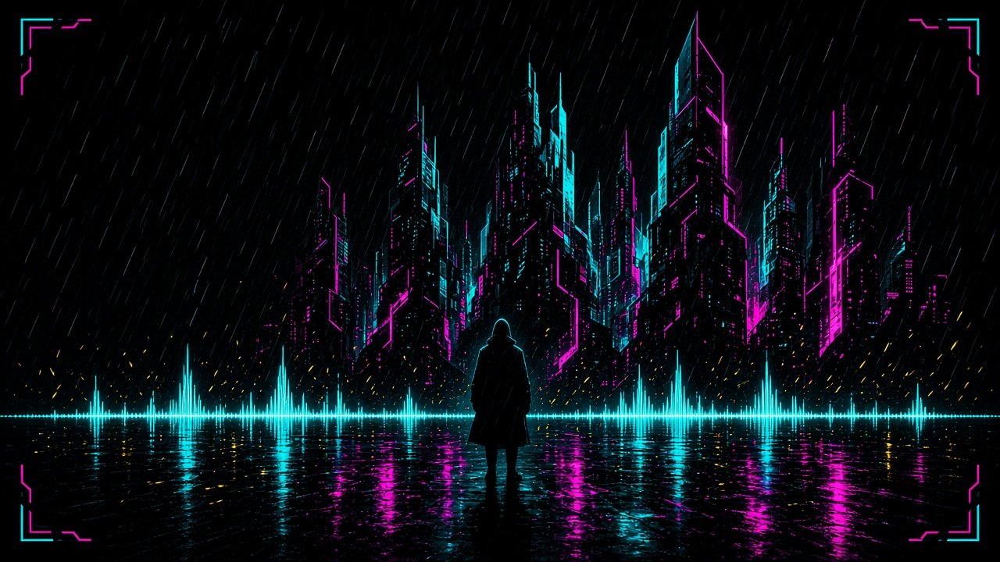

<div align="center">

[](https://git.io/typing-svg)

[](https://github.com/MrNazional)
[](https://github.com/MrNazional)
[](https://github.com/MrNazional)

</div>

---

## // hakkımda

```text
kimlik  Seyit Ali Karakuş
rol     Full Stack Developer · Junior
düğüm   Azerbaycan / Bakü
yığın   Python · React Native · JavaScript · PyQt5 · MySQL
```

- Web, mobil ve masaüstü arayüzleri yazıyorum.
- [UnMixer](https://github.com/MrNazional/UnMixer) ekran kartında şarkıyı ikiye böler: solda müzik, sağda ses. Dosya bilgisayardan çıkmaz.
- Ortak iş ve soru için doğrudan yazabilirsin.

## // bağlantı

[](mailto:kseyitali00@gmail.com)
[](https://github.com/MrNazional)

## // yığın

<table>
<tr>
<td width="50%" valign="top">

### Diller


</td>
<td width="50%" valign="top">

### Arayüz


</td>
</tr>
<tr>
<td width="50%" valign="top">

### Veri ve masaüstü


<br>

[](https://github.com/MrNazional)

</td>
<td width="50%" valign="top">

### Araçlar


</td>
</tr>
</table>

## // sinyal

<div align="center">


<br>


</div>

## // görevler

| proje | ne işe yarıyor |
| --- | --- |
| [UnMixer](https://github.com/MrNazional/UnMixer) | Ekran kartıyla şarkıyı sese ve arka plan müziğine ayırır |
| [reddit-clone](https://github.com/MrNazional/reddit-clone) | TypeScript ile mobil Reddit klonu |
| [Hearth](https://github.com/MrNazional/Hearth) | JavaScript arayüz denemesi |
| [POKEDEX](https://github.com/MrNazional/POKEDEX) | HTML, CSS ve JavaScript ile pokedex |
| [Depo-Stok-Program-](https://github.com/MrNazional/Depo-Stok-Program-) | PyQt5 ve SQLite ile depo stok programı |
| [Auto_Clicker_v1](https://github.com/MrNazional/Auto_Clicker_v1) | PyQt5 ile otomatik tıklayıcı |
